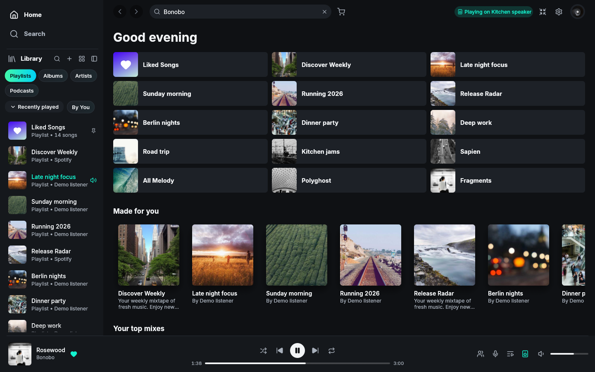
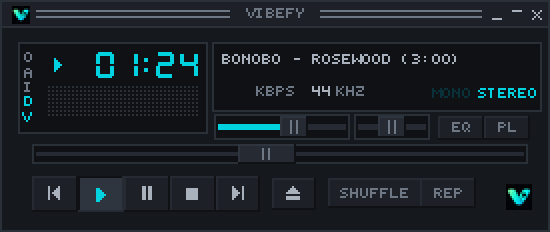

# Vibefy

A desktop music player with YouTube libraries, public Spotify playlist imports, lyrics and optional mods.
Built in Rust, based on [Spotifast](https://github.com/crmne/spotifast).

[Download for Windows](https://github.com/Spinti1/Vibefy/releases/latest) · [Website](https://usevibefy.online) · [Report a bug](https://github.com/Spinti1/Vibefy/issues) · [Credits](CREDITS.md)



*Demo library from an earlier build; the current layout may differ. Sample artwork: [Lorem Picsum](https://picsum.photos/).*

## Features

- **Library:** optional YouTube connection, local Vibefy playlists, public Spotify playlist imports without signing in and optional unlisted YouTube backups. Export/import guest and local playlist backups without storing audio.
- **Playback:** search on Enter or the search button, artist pages, queue controls and a ten-band equalizer.
- **Lyrics:** synchronized or plain lyrics from available providers, with background controls.
- **Visualizers:** 16 built-in effects from Vivy, Backmusic and SoundVisualizer, selected directly in the player.
- **Mods:** optional cats, Track Peek and additional music sources. Install from the in-app catalogue and reload.
- **Listen Together:** desktop and mobile web sessions through Cloudflare, using an invitation link or code.
- **Updates:** check GitHub releases from the profile menu, with size and SHA-256 verification.

## Mini player



The classic mini player comes from **Spotifast**, with Vibefy branding and redesigned colours.

## Install

Download the **Windows x64 Setup** from [Releases](https://github.com/Spinti1/Vibefy/releases/latest). Windows 10/11 and Microsoft Edge WebView2 Runtime are required for YouTube sign-in.

**The installer is unsigned.** Windows SmartScreen may display a warning.

Service limits still apply. Matching songs and lyric timing are not guaranteed for every recording. Optional mods can use more system resources. Playlist copies on YouTube are **unlisted**: anyone with the link can view them.

The [mobile web player](https://usevibefy.online/app) is a separate beta with fewer features. [Details](web/README.md).

## Build

Use the repository's pinned Rust toolchain:

```sh
cargo build --release --locked -j 2
```

The internal build name remains `spotifast`; Windows releases ship as `vibefy.exe`. [Packaging](packaging/vibefy) · [Mod packages](mods/README.md)

## Credits

Vibefy by **Spinti**, based on **Spotifast by Carmine Paolino and contributors**. Lyrics and mods adapt community projects including Spicy Lyrics, More Lyrics and Spicetify extensions.

[Full credits](CREDITS.md) · [Third-party notices](THIRD_PARTY_LICENSES.txt) · [MIT license](LICENSE) · [Support](https://buymeacoffee.com/spinti)

Not affiliated with Spotify, YouTube or Spicetify. Third-party assets retain their original licenses.
